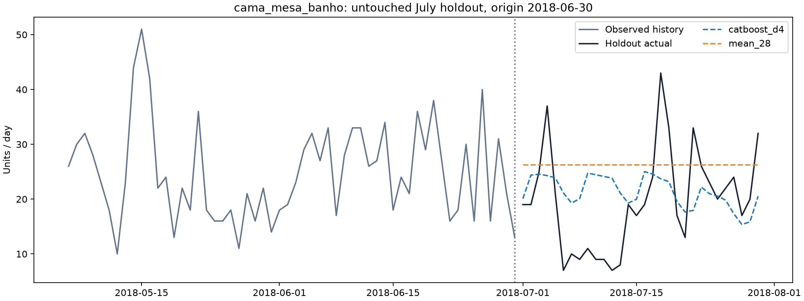
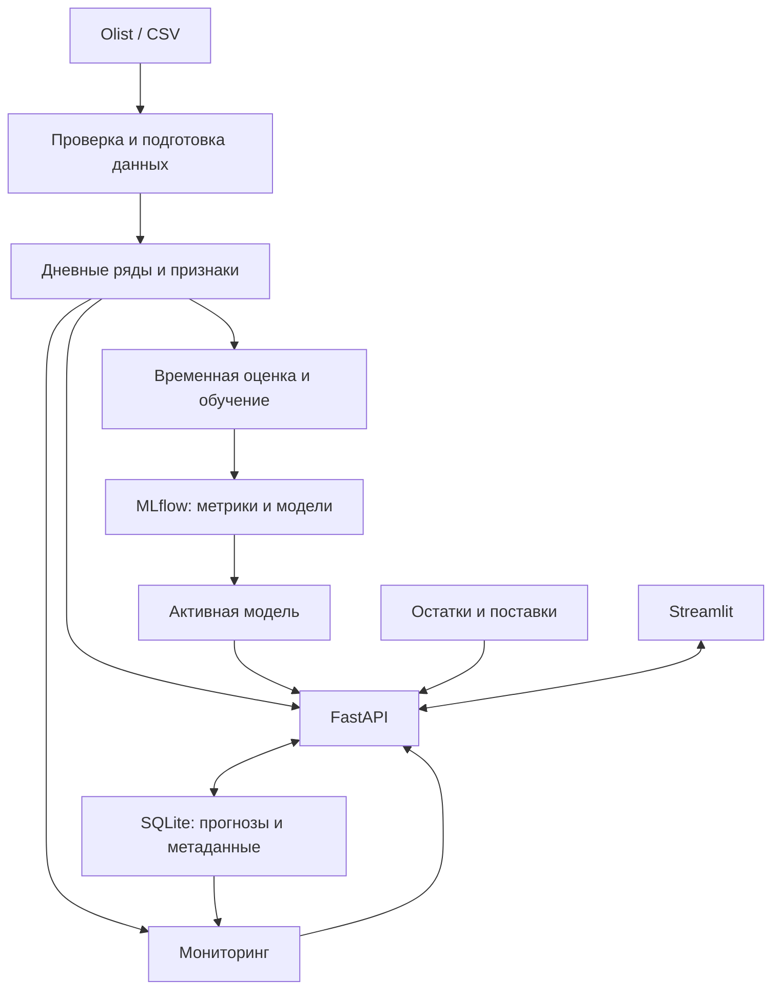

# Demon Plus

ML-сервис прогнозирования продаж и контроля качества модели для небольшого интернет-магазина.

**Статус: этап 5 — мониторинг и Docker Compose.** Доступны прогнозы,
риски запасов, загрузка продаж, переобучение и отчёты data/quality drift.
Следующий этап — оформление демо и подготовка публикации.

## 1. Бизнес-задача

Планируемый сервис прогнозирует продажи по категориям на 7, 14 и 30 дней,
помогает оценить дефицит или избыток запасов и отслеживает изменение данных
и ошибки модели. Прогноз отдельных товаров будет доступен для рядов
с достаточной историей, после проверки данных.

Продажи служат приближением спроса: без истории отсутствия товара невозможно
оценить потерянные продажи. Блок запасов использует отдельно загруженные
остатки и поставки; синтетические примеры будут явно обозначены.

## 2. Скриншоты и демо

Интерфейс уже доступен локально: [запуск и сценарий демо](docs/application.md).
Скриншоты/GIF приложения будут добавлены на этапе 6.
Сейчас доступен график реального прогноза на итоговом тесте. Это отчёт пайплайна,
а не макет интерфейса:



## 3. Архитектура

Ниже — целевая архитектура. Реализованная структура описана в
[руководстве разработчика](docs/development.md).



## 4. Быстрый запуск

С установленным Docker (Linux containers) из корня репозитория:

```bash
docker compose up -d --build
```

Первый запуск скачает Olist и обучит модель. После завершения подготовки откройте
http://127.0.0.1:8502. Данные сохраняются в томах Docker.
[Подробности, логи и остановка](docs/docker.md).

Если данные и модель уже подготовлены, запустите в двух терминалах:

```bash
uv run --locked uvicorn demon_plus.api.app:create_app --factory --host 127.0.0.1 --port 8000
uv run --locked streamlit run src/demon_plus/ui/app.py --server.address 127.0.0.1 --server.port 8501
```

Интерфейс: http://127.0.0.1:8501. Первый запуск с нуля требует загрузки
данных и обучения по инструкции ниже.

Предварительно установите [uv](https://docs.astral.sh/uv/getting-started/installation/)
и откройте терминал в корне репозитория. `uv` установит Python 3.12.13
при необходимости и зависимости из `uv.lock`.

Воспроизвести данные и baseline — две команды, одинаковые для PowerShell и Bash:

```bash
uv run --locked demon-plus fetch-data
uv run --locked demon-plus baseline
```

Первая команда скачивает официальный ZIP Olist v2 (~43 MiB), проверяет SHA-256
и извлекает нужные CSV. Повторный запуск использует локальный архив.
Вторая сохраняет отчёт `artifacts/baseline/report.md`, JSON-метрики, графики
и дневные прогнозы. Данные и локальные артефакты исключены из Git.

Для изменения настроек создайте `.env` из образца. PowerShell:

```powershell
Copy-Item .env.example .env
uv run --locked demon-plus check
```

Linux/macOS:

```bash
cp .env.example .env
uv run --locked demon-plus check
```

Команда выводит в stdout:

```json
{"status":"ok","scope":"configuration","package_version":"0.1.0"}
```

JSON-лог с временем и уровнем выводится отдельно в stderr. Эта проверка
не проверяет БД или модель. При ошибке конфигурации код завершения — `2`.

Без `.env` используются безопасные локальные значения по умолчанию.
Переменные окружения имеют приоритет над `.env`, что пригодится в Docker и CI.
Пустые пути и неизвестные ключи в `.env` считаются ошибкой.
Относительные пути и `.env` разрешаются от текущей рабочей папки.
Команда `check` не создаёт каталоги данных.

Docker Compose выполняет подготовку автоматически; локальные команды полезны для разработки.

После загрузки данных обучить CatBoost и отдельно оценить замороженный итоговый тест:

```bash
uv run --locked demon-plus train
uv run --locked demon-plus evaluate-model
```

Результаты сохраняются в `artifacts/training/<run_id>`. `latest.json` указывает
на последний успешный train. Повторная оценка возвращает сохранённый тестовый результат.
Описание признаков, модели и запуска MLflow UI: [modeling.md](docs/modeling.md).

## 5. Данные и признаки

Источник: [Olist Brazilian E-Commerce Dataset](https://www.kaggle.com/datasets/olistbr/brazilian-ecommerce),
версия 2, лицензия CC BY-NC-SA 4.0. Автор данных — Olist.
Условия и атрибуция: [описание данных](docs/data.md).

В исходных таблицах 99 441 заказ, 112 650 товарных строк и 32 951 товар.
У 18 117 товаров за всю выгрузку продана одна единица — поэтому первый прогноз
строится по категориям. 775 заказов без товарных строк не дают сведений
о количестве и не включаются в целевую величину.

Цель — **заказанные единицы**, включая впоследствии отменённые заказы с товарными
строками. Итоговый статус не используется для фильтрации прошлого. Дата —
локальная дата покупки из источника; доставка и оплата не определяют целевую дату.
Проверяются ключи, связи таблиц и даты; точные дубли удаляются с записью количества,
конфликтующие записи отклоняются.

Реализованы признаки: прошлые продажи, скользящие статистики, доля дней без продаж,
категория, календарь целевой даты и число дней до неё. Все исторические признаки
доступны на дату выпуска прогноза. Будущие фактические продажи, цены,
отзывы и события доставки не используются.

В рабочем окне с 2017-01-05 нет дней без товарных продаж во всём магазине.
Внутри этого окна отсутствие строк категории трактуется как ноль — это явное
допущение, а не доказательство доступности товара. Полностью отсутствующий день
магазина останавливает обработку. См. [EDA и ограничения](docs/eda.md).

## 6. Baseline и итоговая модель

Результаты **валидации** на десяти категориях и трёх временных срезах:

| Модель | Горизонт, дней | MAE, шт./день | RMSE | WAPE дневных продаж | WAPE суммы за горизонт |
|---|---:|---:|---:|---:|---:|
| Повтор последней недели | 7 | 5.814 | 7.665 | 34.61% | 20.89% |
| Повтор последней недели | 14 | 6.360 | 8.569 | 37.00% | 22.40% |
| Повтор последней недели | 30 | 6.833 | 9.171 | 42.43% | 22.40% |
| Среднее последних 28 дней | 7 | 5.118 | 7.023 | 30.46% | 15.95% |
| Среднее последних 28 дней | 14 | 5.584 | 7.531 | 32.49% | 17.05% |
| Среднее последних 28 дней | 30 | 5.774 | 7.606 | 35.86% | 13.24% |
| CatBoost, глубина 4 | 7 | 5.141 | 7.010 | 30.60% | 21.42% |
| CatBoost, глубина 4 | 14 | 5.557 | 7.638 | 32.33% | 22.02% |
| CatBoost, глубина 4 | 30 | 5.593 | 7.646 | 34.73% | 18.23% |

Дневные ошибки объединены по всем категориям и срезам. Последний столбец
сначала суммирует продажи за горизонт отдельно для каждой категории и среза,
затем оценивает ошибку этих сумм. Он полезен для задачи запасов и не заменяет
метрики дневного прогноза. Полные значения, включая MAE/RMSE сумм, метрики по
категориям и срезам: [validation_metrics.json](docs/results/catboost/validation_metrics.json).

MAE измеряет среднюю абсолютную ошибку в штуках; RMSE сильнее учитывает
крупные ошибки. WAPE (%) = 100 × сумма абсолютных ошибок / сумма фактических продаж;
при нулевом знаменателе результат не определён.

История начинается 2017-01-05. Последние наблюдаемые дни перед прогнозом:
2018-03-31, 2018-04-30 и 2018-05-31. В каждом срезе строятся сразу 30 прогнозов;
факты из прогнозируемого периода не обновляют входы модели.

Категории зафиксированы по первому обучающему окну: десять крупнейших по числу
единиц среди категорий хотя бы с 60 днями продаж. Неизвестная категория исключена.
Они покрывают 63.85% единиц этого обучающего окна.

Среднее за 28 дней — основной baseline. Из CatBoost глубины 4 и 6 выбран вариант
глубины 4 по заранее заданному критерию: дневной WAPE для горизонта 30 на валидации
(34.73% против 35.08% у глубины 6 и 35.86% у baseline).
При этом на валидации RMSE и ошибка суммы за горизонт у baseline лучше:
улучшение не универсально, особенно для задачи запасов.

**Итоговый тест: 2018-07-01—2018-07-30.** Модель перед ним обучена до 2018-06-30;
параметры по тесту не менялись. Те же десять категорий, один origin:

| Модель | Горизонт, дней | MAE | RMSE | WAPE дневных продаж | WAPE суммы за горизонт |
|---|---:|---:|---:|---:|---:|
| Среднее последних 28 дней | 7 | 5.126 | 6.814 | 38.50% | 17.62% |
| Среднее последних 28 дней | 14 | 6.057 | 7.720 | 53.84% | 37.49% |
| Среднее последних 28 дней | 30 | 5.432 | 7.117 | 39.11% | 13.15% |
| CatBoost, глубина 4 | 7 | 4.172 | 5.391 | 31.34% | 8.95% |
| CatBoost, глубина 4 | 14 | 5.246 | 6.568 | 46.63% | 25.97% |
| CatBoost, глубина 4 | 30 | 5.102 | 6.766 | 36.73% | 10.19% |

На 30 днях тестовый WAPE уменьшился на 2.38 процентного пункта, примерно на 6.1%
относительно baseline. Один тестовый месяц не доказывает устойчивость эффекта.
14-дневная ошибка остаётся высокой. Полная разбивка и второй baseline:
[holdout_metrics.json](docs/results/catboost/holdout_metrics.json).
Более поздний хвост данных не использовался. Случайного разбиения нет.

## 7. API, MLflow и мониторинг

FastAPI обслуживает прогнозы, расчёт запасов, загрузку данных и переобучение.
Streamlit обращается к API. SQLite хранит прогнозы, версии и задачи;
MLflow уже хранит историю экспериментов и артефакты моделей отдельно:
локальная SQLite, дочерние запуски кандидатов/срезов, метрики и нативные `.cbm`.
Финальный тест записывается отдельным запуском со ссылкой на выбор модели.

Мониторинг сравнивает распределения продаж через Evidently и оценивает ошибку
сохранённых прогнозов при поступлении фактов. Data drift не равен ухудшению качества;
без полных фактов качество остаётся неоценённым. Пороги распределений вычисляются
по истории до обучения; пороги ухудшения WAPE — настраиваемая эвристика.
Отчёт обновляется по запросу в разделе «Качество», без фонового планировщика.
[Окна, пороги и ограничения](docs/monitoring.md).

Новый CSV проходит проверку и создаёт версию данных. Переобученная модель
сначала сравнивается с действующей; загрузка файла не означает автоматическую
замену модели. [Контракт CSV, API и сценарий обновления](docs/application.md).

## 8. Ограничения и развитие

Это локальный учебный проект с одним процессом API и SQLite.
Реализованы пайплайн, CatBoost, MLflow, хранилище, интерфейс, мониторинг и контейнеризация.
Мониторинг использует дневные продажи по категориям, а качество сравнивает
на полных неперекрывающихся горизонтах одной версии модели.

Даже после MVP исторические данные не будут означать прогноз современного рынка,
а синтетические остатки не будут реальными складскими данными. Оценка категории
не гарантирует наличие конкретного товара. Интервалы неопределённости требуют
отдельной проверки; точечный прогноз не даёт вероятность дефицита.

Для настоящего production потребуются аутентификация, разграничение доступа,
резервное копирование, PostgreSQL, надёжные фоновые задачи, автоматизация поступления
фактов, контроль задержек и нагрузочные проверки. Облако не обязательно для MVP.

## 9. Показанные навыки

Сейчас: Python 3.12, src-layout, типизированные настройки и Pydantic-схемы,
JSON-логирование, CLI, pytest, ruff, mypy, pre-commit и конфигурация GitHub Actions.
Также: проверка реальных связанных таблиц, EDA, агрегация временных рядов,
два baseline, временная валидация, тесты отсутствия утечки и воспроизводимые отчёты.
Добавлены feature engineering, CatBoost, MLflow, проверка сохранения/загрузки модели
и независимый тест после выбора параметров.
GitHub Actions требует публикации репозитория; удалённого запуска ещё не было.

Также реализованы REST API, Streamlit, версионирование продаж, фоновые задачи
и проверяемое применение модели, Evidently, quality drift и запуск в Docker.

См. [план этапов](docs/roadmap.md) и [правила разработки](docs/development.md).
