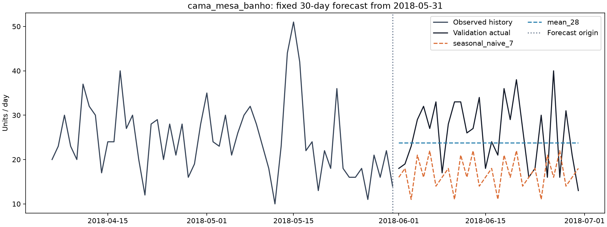
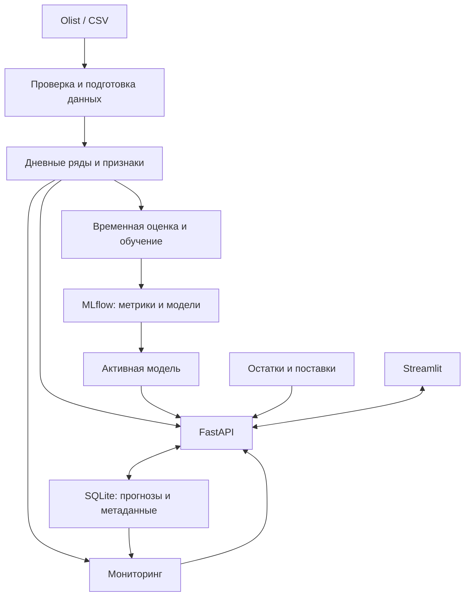

# Demon Plus

ML-сервис прогнозирования продаж и контроля качества модели для небольшого интернет-магазина.

**Статус: этап 2 — данные, EDA и baseline готовы.** Доступны загрузка Olist,
проверка и агрегация данных, два baseline, временная оценка и графики.
CatBoost, API, интерфейс и мониторинг — следующие этапы.

## 1. Бизнес-задача

Планируемый сервис прогнозирует продажи по категориям на 7, 14 и 30 дней,
помогает оценить дефицит или избыток запасов и отслеживает изменение данных
и ошибки модели. Прогноз отдельных товаров будет доступен для рядов
с достаточной историей, после проверки данных.

Продажи служат приближением спроса: без истории отсутствия товара невозможно
оценить потерянные продажи. Блок запасов использует отдельно загруженные
остатки и поставки; синтетические примеры будут явно обозначены.

## 2. Скриншоты и демо

Интерфейс появится на этапе 4, скриншоты/GIF — на этапе 6.
Сейчас доступен график реального валидационного прогноза. Это отчёт пайплайна,
а не макет интерфейса:



## 3. Архитектура

Ниже — целевая архитектура. Реализованная структура описана в
[руководстве разработчика](docs/development.md).



## 4. Быстрый запуск

Предварительно установите [uv](https://docs.astral.sh/uv/getting-started/installation/)
и откройте терминал в корне репозитория. `uv` установит Python 3.12.13
при необходимости и зависимости из `uv.lock`.

Воспроизвести данные и baseline — две команды, одинаковые для PowerShell и Bash:

```bash
uv run --locked demon-plus fetch-data
uv run --locked demon-plus baseline
```

Первая команда скачивает официальный ZIP Olist v2 (~43 MiB), проверяет SHA-256
и извлекает нужные CSV. Повторный запуск использует локальный архив.
Вторая сохраняет отчёт `artifacts/baseline/report.md`, JSON-метрики, графики
и дневные прогнозы. Данные и локальные артефакты исключены из Git.

Для изменения настроек создайте `.env` из образца. PowerShell:

```powershell
Copy-Item .env.example .env
uv run --locked demon-plus check
```

Linux/macOS:

```bash
cp .env.example .env
uv run --locked demon-plus check
```

Команда выводит в stdout:

```json
{"status":"ok","scope":"configuration","package_version":"0.1.0"}
```

JSON-лог с временем и уровнем выводится отдельно в stderr. Эта проверка
не проверяет БД или модель. При ошибке конфигурации код завершения — `2`.

Без `.env` используются безопасные локальные значения по умолчанию.
Переменные окружения имеют приоритет над `.env`, что пригодится в Docker и CI.
Пустые пути и неизвестные ключи в `.env` считаются ошибкой.
Относительные пути и `.env` разрешаются от текущей рабочей папки.
Команда `check` не создаёт каталоги данных.

Docker Compose и полный деморежим появятся на этапе 5.

## 5. Данные и признаки

Источник: [Olist Brazilian E-Commerce Dataset](https://www.kaggle.com/datasets/olistbr/brazilian-ecommerce),
версия 2, лицензия CC BY-NC-SA 4.0. Автор данных — Olist.
Условия и атрибуция: [описание данных](docs/data.md).

В исходных таблицах 99 441 заказ, 112 650 товарных строк и 32 951 товар.
У 18 117 товаров за всю выгрузку продана одна единица — поэтому первый прогноз
строится по категориям. 775 заказов без товарных строк не дают сведений
о количестве и не включаются в целевую величину.

Цель — **заказанные единицы**, включая впоследствии отменённые заказы с товарными
строками. Итоговый статус не используется для фильтрации прошлого. Дата —
локальная дата покупки из источника; доставка и оплата не определяют целевую дату.
Проверяются ключи, связи таблиц и даты; точные дубли удаляются с записью количества,
конфликтующие записи отклоняются.

План признаков: прошлые продажи, скользящие статистики, доля дней без продаж,
категория, календарь целевой даты и число дней до неё. Все исторические признаки
доступны на дату выпуска прогноза. Будущие фактические продажи, цены,
отзывы и события доставки не используются.

В рабочем окне с 2017-01-05 нет дней без товарных продаж во всём магазине.
Внутри этого окна отсутствие строк категории трактуется как ноль — это явное
допущение, а не доказательство доступности товара. Полностью отсутствующий день
магазина останавливает обработку. См. [EDA и ограничения](docs/eda.md).

## 6. Baseline и итоговая модель

Результаты **валидации** на десяти категориях и трёх временных срезах:

| Модель | Горизонт, дней | MAE, шт./день | RMSE | WAPE дневных продаж | WAPE суммы за горизонт |
|---|---:|---:|---:|---:|---:|
| Повтор последней недели | 7 | 5.814 | 7.665 | 34.61% | 20.89% |
| Повтор последней недели | 14 | 6.360 | 8.569 | 37.00% | 22.40% |
| Повтор последней недели | 30 | 6.833 | 9.171 | 42.43% | 22.40% |
| Среднее последних 28 дней | 7 | 5.118 | 7.023 | 30.46% | 15.95% |
| Среднее последних 28 дней | 14 | 5.584 | 7.531 | 32.49% | 17.05% |
| Среднее последних 28 дней | 30 | 5.774 | 7.606 | 35.86% | 13.24% |
| CatBoost | — | — | — | — | Этап 3 |

Дневные ошибки объединены по всем категориям и срезам. Последний столбец
сначала суммирует продажи за горизонт отдельно для каждой категории и среза,
затем оценивает ошибку этих сумм. Он полезен для задачи запасов и не заменяет
метрики дневного прогноза. Полные значения, включая MAE/RMSE сумм, метрики по
категориям и срезам: [metrics.json](docs/results/metrics.json).

MAE измеряет среднюю абсолютную ошибку в штуках; RMSE сильнее учитывает
крупные ошибки. WAPE (%) = 100 × сумма абсолютных ошибок / сумма фактических продаж;
при нулевом знаменателе результат не определён.

История начинается 2017-01-05. Последние наблюдаемые дни перед прогнозом:
2018-03-31, 2018-04-30 и 2018-05-31. В каждом срезе строятся сразу 30 прогнозов;
факты из прогнозируемого периода не обновляют входы модели.

Категории зафиксированы по первому обучающему окну: десять крупнейших по числу
единиц среди категорий хотя бы с 60 днями продаж. Неизвестная категория исключена.
Они покрывают 63.85% единиц этого обучающего окна.

Среднее за 28 дней — baseline для следующего этапа по WAPE дневных прогнозов
на горизонте 30. CatBoost будет сравниваться на тех же срезах.
**Итоговый тест 2018-07-01—2018-07-30 пока не оценивался.** Более поздний хвост
выгрузки не используется для подбора или оценки модели. Случайного разбиения нет.

## 7. API, MLflow и мониторинг

План: FastAPI обслуживает прогнозы, расчёт запасов, загрузку данных и результаты
мониторинга. Streamlit обращается к API. SQLite хранит прогнозы и метаданные;
MLflow хранит историю экспериментов и артефакты моделей отдельно.

Мониторинг включает проверки качества данных, сравнение распределений
через Evidently и оценку ошибки ранее сохранённых прогнозов при поступлении
фактических продаж. Data drift не равен ухудшению качества; без фактов статус
качества — «ещё не оценено». Пороги будут выбраны на исторических окнах.

Новый CSV проходит проверку и создаёт версию данных. Переобученная модель
сначала сравнивается с действующей; загрузка файла не означает автоматическую
замену модели. Эти компоненты появятся на этапах 3–5.

## 8. Ограничения и развитие

Это локальный учебный проект. Сейчас реализован пайплайн данных и baseline;
CatBoost, хранилище приложения, веб-сервис и интерфейс ещё отсутствуют.

Даже после MVP исторические данные не будут означать прогноз современного рынка,
а синтетические остатки не будут реальными складскими данными. Оценка категории
не гарантирует наличие конкретного товара. Интервалы неопределённости требуют
отдельной проверки; точечный прогноз не даёт вероятность дефицита.

Для настоящего production потребуются аутентификация, разграничение доступа,
резервное копирование, PostgreSQL, надёжные фоновые задачи, автоматизация поступления
фактов, контроль задержек и нагрузочные проверки. Облако не обязательно для MVP.

## 9. Показанные навыки

Сейчас: Python 3.12, src-layout, типизированные настройки и Pydantic-схемы,
JSON-логирование, CLI, pytest, ruff, mypy, pre-commit и конфигурация GitHub Actions.
Также: проверка реальных связанных таблиц, EDA, агрегация временных рядов,
два baseline, временная валидация, тесты отсутствия утечки и воспроизводимые отчёты.
GitHub Actions требует публикации репозитория; удалённого запуска ещё не было.

По завершении: feature engineering, CatBoost, трекинг экспериментов, API, интерфейс,
мониторинг ML и воспроизводимый запуск в Docker.

См. [план этапов](docs/roadmap.md) и [правила разработки](docs/development.md).
