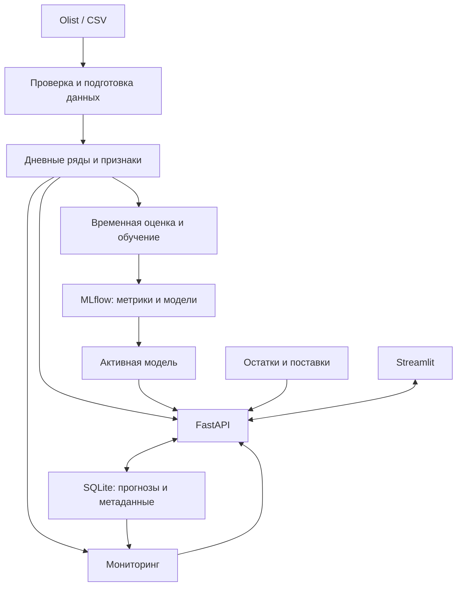

# Demon Plus

ML-сервис прогнозирования продаж и контроля качества модели для небольшого интернет-магазина.

**Статус: этап 1 — основа проекта.** Сейчас доступны установка Python-пакета,
проверка конфигурации, структурированные логи и инструменты качества.
Прогнозирование, API, интерфейс и мониторинг ещё не реализованы.

## 1. Бизнес-задача

Планируемый сервис прогнозирует продажи по категориям на 7, 14 и 30 дней,
помогает оценить дефицит или избыток запасов и отслеживает изменение данных
и ошибки модели. Прогноз отдельных товаров будет доступен для рядов
с достаточной историей, после проверки данных.

Продажи служат приближением спроса: без истории отсутствия товара невозможно
оценить потерянные продажи. Блок запасов использует отдельно загруженные
остатки и поставки; синтетические примеры будут явно обозначены.

## 2. Скриншоты и демо

Интерфейс появится на этапе 4. Реальные скриншоты и GIF будут добавлены
на этапе 6; пока доступна только команда проверки конфигурации.

## 3. Архитектура

Ниже — целевая архитектура. Реализованная структура описана в
[руководстве разработчика](docs/development.md).



## 4. Быстрый запуск

Предварительно установите [uv](https://docs.astral.sh/uv/getting-started/installation/)
и откройте терминал в корне репозитория. `uv` установит Python 3.12.13
при необходимости и зависимости из `uv.lock`.

PowerShell:

```powershell
Copy-Item .env.example .env
uv run --locked demon-plus check
```

Linux/macOS:

```bash
cp .env.example .env
uv run --locked demon-plus check
```

Команда выводит в stdout:

```json
{"status":"ok","scope":"configuration","package_version":"0.1.0"}
```

JSON-лог с временем и уровнем выводится отдельно в stderr. Эта проверка
не проверяет БД или модель. При ошибке конфигурации код завершения — `2`.

Без `.env` используются безопасные локальные значения по умолчанию.
Переменные окружения имеют приоритет над `.env`, что пригодится в Docker и CI.
Пустые пути и неизвестные ключи в `.env` считаются ошибкой.
Относительные пути и `.env` разрешаются от текущей рабочей папки.
Команда `check` не создаёт каталоги данных.

Docker Compose и полный деморежим появятся на этапе 5.

## 5. Данные и признаки

Планируемый источник: [Olist Brazilian E-Commerce Dataset](https://www.kaggle.com/datasets/olistbr/brazilian-ecommerce).
На этапе 2 проверим схему, условия использования и способ скачивания,
полноту дат, статусы заказов, дубли и плотность рядов. Данные пока не скачаны.
Крупные исходные файлы и модели не включаются в Git.

План признаков: прошлые продажи, скользящие статистики, доля дней без продаж,
категория, календарь целевой даты и число дней до неё. Все исторические признаки
доступны на дату выпуска прогноза. Будущие фактические продажи, цены,
отзывы и события доставки не используются.

Пропущенные даты нельзя автоматически считать нулевыми продажами:
сначала проверим полноту выгрузки и период наблюдения.

## 6. Baseline и итоговая модель

Обучения ещё не было; численные результаты появятся после воспроизводимого
временного сравнения. CatBoost не считается лучше baseline заранее.

| Модель | MAE | RMSE | WAPE | Статус |
|---|---|---|---|---|
| Повтор последней недели | — | — | — | Этап 2 |
| Среднее последних четырёх недель | — | — | — | Этап 2 |
| CatBoost по категориям | — | — | — | Этап 3 |

MAE измеряет среднюю абсолютную ошибку в штуках; RMSE сильнее учитывает
крупные ошибки. WAPE = сумма абсолютных ошибок / сумма фактических продаж;
при нулевом знаменателе результат не определён.

Оценка будет выполнена по одинаковым категориям, датам выпуска и горизонтам
7/14/30 дней с последовательными временными срезами. Последний полный период
останется для итогового теста. Отбор рядов и настройка моделей используют только
обучающие/валидационные периоды. Для обучающей строки вся её целевая информация
должна быть известна к границе обучения. Случайное разбиение не используется.

## 7. API, MLflow и мониторинг

План: FastAPI обслуживает прогнозы, расчёт запасов, загрузку данных и результаты
мониторинга. Streamlit обращается к API. SQLite хранит прогнозы и метаданные;
MLflow хранит историю экспериментов и артефакты моделей отдельно.

Мониторинг включает проверки качества данных, сравнение распределений
через Evidently и оценку ошибки ранее сохранённых прогнозов при поступлении
фактических продаж. Data drift не равен ухудшению качества; без фактов статус
качества — «ещё не оценено». Пороги будут выбраны на исторических окнах.

Новый CSV проходит проверку и создаёт версию данных. Переобученная модель
сначала сравнивается с действующей; загрузка файла не означает автоматическую
замену модели. Эти компоненты появятся на этапах 3–5.

## 8. Ограничения и развитие

Это локальный учебный проект. На текущем этапе отсутствуют ML-пайплайн,
хранилище, веб-сервис и пользовательский интерфейс.

Даже после MVP исторические данные не будут означать прогноз современного рынка,
а синтетические остатки не будут реальными складскими данными. Оценка категории
не гарантирует наличие конкретного товара. Интервалы неопределённости требуют
отдельной проверки; точечный прогноз не даёт вероятность дефицита.

Для настоящего production потребуются аутентификация, разграничение доступа,
резервное копирование, PostgreSQL, надёжные фоновые задачи, автоматизация поступления
фактов, контроль задержек и нагрузочные проверки. Облако не обязательно для MVP.

## 9. Показанные навыки

Сейчас: Python 3.12, src-layout, типизированные настройки и Pydantic-схемы,
JSON-логирование, CLI, pytest, ruff, mypy, pre-commit и конфигурация GitHub Actions.
GitHub Actions требует публикации репозитория; удалённого запуска ещё не было.

По завершении: подготовка реальных данных, временная валидация без утечки,
feature engineering, CatBoost, трекинг экспериментов, API, интерфейс,
мониторинг ML и воспроизводимый запуск в Docker.

См. [план этапов](docs/roadmap.md) и [правила разработки](docs/development.md).
