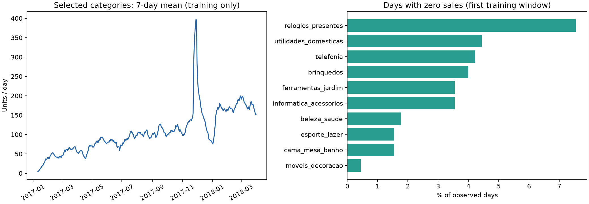

# EDA и выбор baseline

Данные: Olist v2. Команда воспроизведения — `uv run --locked demon-plus baseline`
после `fetch-data`. Числа аудита всей выгрузки используются для описания её охвата;
когорта категорий и график обучения строятся только до первого среза.

## Что обнаружено

| Наблюдение | Значение | Решение |
|---|---:|---|
| Заказы | 99 441 | Соединять с позициями по ключу |
| Товарные строки | 112 650 | Одна строка — одна единица |
| Товары | 32 951 | Сначала агрегировать по категориям |
| Товары с одной единицей за всю выгрузку | 18 117 | Индивидуальные ряды часто разрежены |
| Товары с не более чем десятью единицами | 31 283 | Прогноз всех SKU пока не обоснован |
| Заказы без позиций | 775 | Учесть в аудите, не выдумывать количество |
| Единицы без категории | 1 603 | Сохранить как unknown, исключить из когорты |
| Точные дубли в трёх рабочих таблицах | 0 | Проверку оставить для повторных загрузок |

Товарные строки охватывают 2016-09-04—2018-09-03. Начальный хвост очень редкий:
в сентябре 2016 шесть единиц, в октябре 363, в декабре одна. За 1–4 января 2017
нет товарных строк. Рабочая история начинается 2017-01-05. В сентябре 2018
присутствует всего одна единица; хвост выгрузки не используется для оценки.

## Когорта и обучение

На 2018-03-31 отобраны десять крупнейших категорий среди имеющих не менее
60 дней с ненулевыми продажами. Они зафиксированы для всех дальнейших срезов
и покрывают 47 862 единицы, или 63.8492% объёма первого обучающего окна.
Полный список и доли нулевых дней — в [eda.json](results/eda.json).

График показывает рост объёма и заметный пик в конце 2017 года. По одному графику
нельзя установить причину пика. Это аргумент для проверки календарных признаков,
а не для удаления всплеска как ошибки. Доля нулевых дней выбранных категорий
составляет примерно 0.44–7.54%, что делает их удобнее для первого прогнозного MVP.

## Временная оценка

| Последний наблюдаемый день | Прогнозируемые 30 дней | Назначение |
|---|---|---|
| 2018-03-31 | 2018-04-01—2018-04-30 | Валидация 1 |
| 2018-04-30 | 2018-05-01—2018-05-30 | Валидация 2 |
| 2018-05-31 | 2018-06-01—2018-06-30 | Валидация 3 |
| 2018-06-30 | 2018-07-01—2018-07-30 | Зарезервированный итоговый тест |

В каждом срезе модель получает только историю до соответствующей даты.
`seasonal_naive_7` циклически повторяет последнюю известную неделю;
`mean_28` повторяет среднее последних 28 дней. На 8-й и последующие дни
не подставляются реальные продажи из валидационного периода.

Отдельно считаются первые 7, 14 и 30 дней одного прогноза. Для каждого горизонта
сравниваются одни и те же категории и даты. MAE/RMSE/WAPE объединяют дневные ошибки,
поэтому крупные категории сильнее влияют на общий WAPE. Разбивка по категориям
и срезам сохранена для анализа, а не скрыта общей цифрой.

## Результат и интерпретация

На горизонте 30 дней дневной WAPE: **35.86% у mean_28 против 42.43% у seasonal_naive_7**.
Среднее за 28 дней сглаживает шум последней недели; на этих срезах это полезнее
точного повторения её формы. Среднее выигрывает по агрегированным метрикам
на всех трёх горизонтах. Это не гарантирует выигрыша в каждой категории или в будущем.

WAPE суммарных 30-дневных продаж составляет 13.24% и 22.40% соответственно:
ошибки отдельных дней могут компенсироваться при суммировании. Для запасов важны
и сумма, и распределение продаж по дням — низкая ошибка суммы не гарантирует
правильную дату дефицита.

Выбран **mean_28** как ориентир для CatBoost по заранее записанному критерию:
дневной WAPE на горизонте 30 по валидационным срезам. Итоговый июльский тест
не оценивался; его дневные значения не включены в обработанную панель.

На этапе 3 будем проверять календарь, лаги и скользящие статистики в тех же срезах.
Превосходство CatBoost не предполагается заранее. Для интерпретации результатов
сохраняются ограничения: заказы вместо истинного спроса, неизвестные stockout,
нет временных версий справочника товаров и истории исправления записей.
